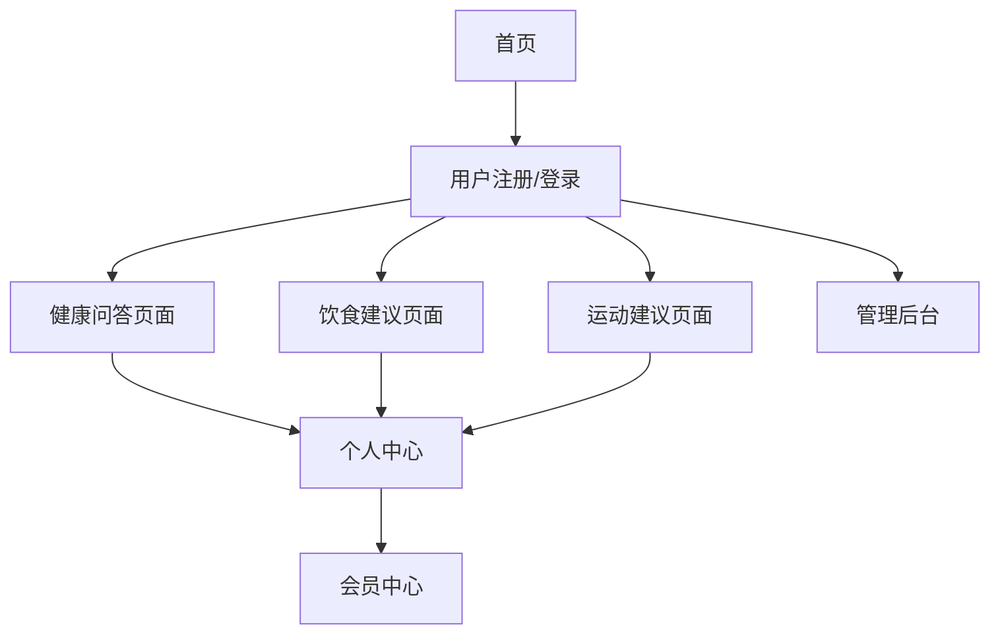

# AI健康顾问网站产品需求文档

## 1. 产品概述

AI健康顾问网站是一个基于人工智能技术的个性化健康管理平台，为用户提供智能健康问答、个性化饮食建议和运动指导服务。

- 解决用户在日常健康管理中缺乏专业指导的问题，通过AI技术提供24/7的健康咨询服务。
- 目标用户包括关注健康的普通用户、慢性病患者、健身爱好者等群体。
- 产品旨在成为用户身边的智能健康助手，提升全民健康管理水平。

## 2. 核心功能

### 2.1 用户角色

| 角色 | 注册方式 | 核心权限 |
|------|----------|----------|
| 普通用户 | 邮箱注册或第三方登录 | 基础健康问答、查看通用建议 |
| 会员用户 | 付费升级 | 个性化建议、详细报告、专属客服 |
| 管理员 | 内部邀请 | 内容管理、用户管理、数据分析 |

### 2.2 功能模块

我们的AI健康顾问网站包含以下主要页面：

1. **首页**：产品介绍、功能导航、用户登录入口
2. **健康问答页面**：智能对话界面、问题分类、历史记录
3. **饮食建议页面**：个人信息录入、饮食方案生成、营养分析
4. **运动建议页面**：体能评估、运动计划制定、进度跟踪
5. **个人中心**：用户资料、健康档案、使用记录
6. **会员中心**：套餐选择、支付管理、专属服务

### 2.3 页面详情

| 页面名称 | 模块名称 | 功能描述 |
|----------|----------|----------|
| 首页 | 产品介绍区 | 展示产品核心价值、功能亮点、用户评价 |
| 首页 | 快速体验区 | 提供简单健康测试、AI问答体验入口 |
| 首页 | 导航菜单 | 清晰的功能分类导航、用户登录注册入口 |
| 健康问答页面 | 智能对话界面 | 支持文字输入、语音识别、多轮对话、上下文理解 |
| 健康问答页面 | 问题分类系统 | 常见问题分类、热门话题推荐、专科问题导航 |
| 健康问答页面 | 历史记录管理 | 对话历史保存、问题收藏、答案分享功能 |
| 饮食建议页面 | 个人信息采集 | 身高体重、年龄性别、健康状况、饮食偏好录入 |
| 饮食建议页面 | 智能方案生成 | 基于个人信息生成个性化饮食计划、营养搭配建议 |
| 饮食建议页面 | 营养分析工具 | 卡路里计算、营养成分分析、饮食记录跟踪 |
| 运动建议页面 | 体能评估系统 | 基础体能测试、运动能力评估、健康风险筛查 |
| 运动建议页面 | 运动计划制定 | 个性化运动方案、强度调节、时间安排 |
| 运动建议页面 | 进度跟踪功能 | 运动记录、效果评估、目标调整、激励机制 |
| 个人中心 | 用户资料管理 | 个人信息编辑、健康档案维护、隐私设置 |
| 个人中心 | 健康报告 | 定期健康评估报告、趋势分析、改善建议 |
| 会员中心 | 套餐管理 | 会员等级展示、套餐对比、续费管理 |
| 会员中心 | 专属服务 | 专家咨询预约、个性化报告、优先客服 |

## 3. 核心流程

**普通用户流程：**
用户访问首页 → 注册/登录 → 选择服务类型（问答/饮食/运动） → 填写基本信息 → 获得AI建议 → 查看历史记录

**会员用户流程：**
用户登录 → 访问会员专区 → 完善详细健康档案 → 获得深度个性化建议 → 定期接收健康报告 → 预约专家咨询

**管理员流程：**
管理员登录 → 访问后台管理 → 内容审核与更新 → 用户数据分析 → 系统维护与优化

## 4. 用户界面设计

### 4.1 设计风格

- **主色调**：医疗蓝(#2E86AB)作为主色，搭配清新绿(#A8DADC)作为辅助色
- **按钮样式**：圆角矩形按钮，支持悬停效果和点击反馈
- **字体**：中文使用思源黑体，英文使用Roboto，主要字号16px，标题24px
- **布局风格**：卡片式设计，左侧导航栏，响应式布局
- **图标风格**：线性图标风格，配合健康主题的插画元素

### 4.2 页面设计概览

| 页面名称 | 模块名称 | UI元素 |
|----------|----------|--------|
| 首页 | 产品介绍区 | 大图背景、渐变色彩、动态效果、CTA按钮 |
| 首页 | 快速体验区 | 卡片布局、图标导航、悬停效果 |
| 健康问答页面 | 对话界面 | 聊天气泡样式、打字动画、语音按钮、清晰的用户/AI区分 |
| 饮食建议页面 | 信息录入 | 表单设计、进度条、输入验证、友好的错误提示 |
| 饮食建议页面 | 方案展示 | 营养图表、食物图片、卡路里显示、收藏按钮 |
| 运动建议页面 | 计划展示 | 时间轴设计、运动图标、强度标识、完成状态 |
| 个人中心 | 数据展示 | 仪表盘样式、图表可视化、趋势线、健康评分 |

### 4.3 响应式设计

网站采用移动优先的响应式设计，支持桌面端、平板和手机端访问。在移动端优化触摸交互，增大点击区域，简化操作流程。桌面端充分利用屏幕空间，提供更丰富的信息展示和交互功能。