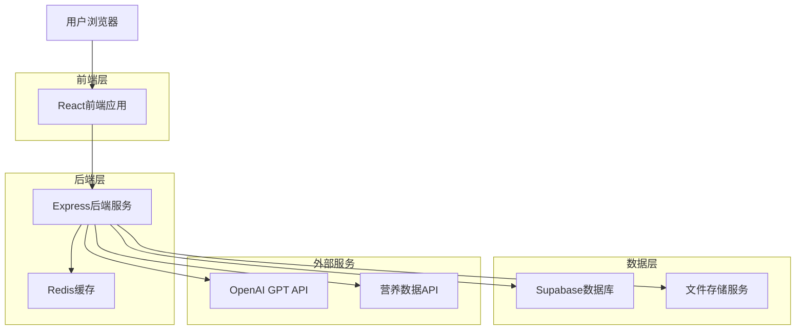
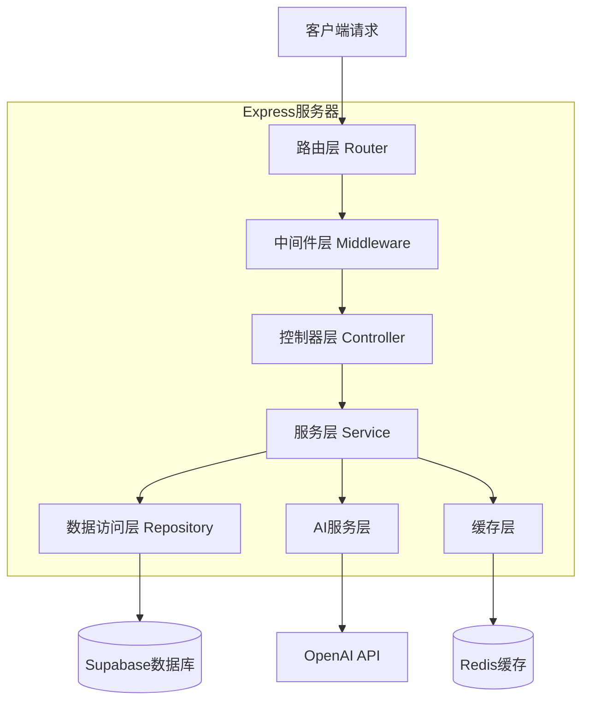
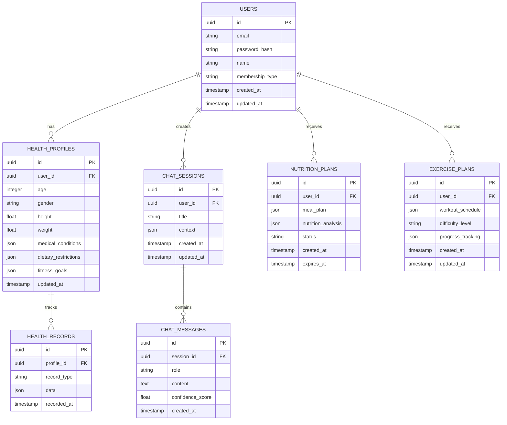

# AI健康顾问网站技术架构文档

## 1. 架构设计



## 2. 技术描述

* **前端**: React\@18 + TypeScript + Tailwind CSS + Vite

* **后端**: Express\@4 + TypeScript + JWT认证

* **数据库**: Supabase (PostgreSQL)

* **缓存**: Redis\@7

* **AI服务**: OpenAI GPT-4 API

* **部署**: Vercel (前端) + Railway (后端)

## 3. 路由定义

| 路由          | 用途               |
| ----------- | ---------------- |
| /           | 首页，展示产品介绍和快速体验入口 |
| /login      | 登录页面，用户身份验证      |
| /register   | 注册页面，新用户注册       |
| /chat       | 健康问答页面，AI对话界面    |
| /nutrition  | 饮食建议页面，个性化营养方案   |
| /exercise   | 运动建议页面，运动计划制定    |
| /profile    | 个人中心，用户资料和健康档案   |
| /membership | 会员中心，套餐管理和专属服务   |
| /admin      | 管理后台，内容和用户管理     |

## 4. API定义

### 4.1 用户认证相关

**用户注册**

```
POST /api/auth/register
```

请求参数:

| 参数名      | 参数类型   | 是否必需 | 描述   |
| -------- | ------ | ---- | ---- |
| email    | string | true | 用户邮箱 |
| password | string | true | 用户密码 |
| name     | string | true | 用户姓名 |

响应参数:

| 参数名     | 参数类型    | 描述      |
| ------- | ------- | ------- |
| success | boolean | 注册是否成功  |
| token   | string  | JWT认证令牌 |
| user    | object  | 用户基本信息  |

**用户登录**

```
POST /api/auth/login
```

请求参数:

| 参数名      | 参数类型   | 是否必需 | 描述   |
| -------- | ------ | ---- | ---- |
| email    | string | true | 用户邮箱 |
| password | string | true | 用户密码 |

### 4.2 健康问答相关

**发送健康问题**

```
POST /api/chat/ask
```

请求参数:

| 参数名      | 参数类型   | 是否必需  | 描述     |
| -------- | ------ | ----- | ------ |
| question | string | true  | 用户健康问题 |
| context  | array  | false | 对话上下文  |
| userId   | string | true  | 用户ID   |

响应参数:

| 参数名         | 参数类型   | 描述      |
| ----------- | ------ | ------- |
| answer      | string | AI生成的回答 |
| confidence  | number | 回答置信度   |
| suggestions | array  | 相关建议    |

### 4.3 饮食建议相关

**生成饮食方案**

```
POST /api/nutrition/plan
```

请求参数:

| 参数名         | 参数类型   | 是否必需  | 描述     |
| ----------- | ------ | ----- | ------ |
| userProfile | object | true  | 用户健康档案 |
| goals       | array  | true  | 健康目标   |
| preferences | object | false | 饮食偏好   |

响应参数:

| 参数名               | 参数类型   | 描述   |
| ----------------- | ------ | ---- |
| mealPlan          | object | 饮食计划 |
| nutritionAnalysis | object | 营养分析 |
| recommendations   | array  | 推荐食谱 |

### 4.4 运动建议相关

**生成运动计划**

```
POST /api/exercise/plan
```

请求参数:

| 参数名           | 参数类型   | 是否必需  | 描述       |
| ------------- | ------ | ----- | -------- |
| fitnessLevel  | string | true  | 体能水平     |
| goals         | array  | true  | 运动目标     |
| timeAvailable | number | true  | 可用时间(分钟) |
| equipment     | array  | false | 可用器械     |

## 5. 服务器架构图



## 6. 数据模型

### 6.1 数据模型定义



### 6.2 数据定义语言

**用户表 (users)**

```sql
-- 创建用户表
CREATE TABLE users (
    id UUID PRIMARY KEY DEFAULT gen_random_uuid(),
    email VARCHAR(255) UNIQUE NOT NULL,
    password_hash VARCHAR(255) NOT NULL,
    name VARCHAR(100) NOT NULL,
    membership_type VARCHAR(20) DEFAULT 'free' CHECK (membership_type IN ('free', 'premium', 'vip')),
    created_at TIMESTAMP WITH TIME ZONE DEFAULT NOW(),
    updated_at TIMESTAMP WITH TIME ZONE DEFAULT NOW()
);

-- 创建索引
CREATE INDEX idx_users_email ON users(email);
CREATE INDEX idx_users_membership ON users(membership_type);

-- 设置权限
GRANT SELECT ON users TO anon;
GRANT ALL PRIVILEGES ON users TO authenticated;
```

**健康档案表 (health\_profiles)**

```sql
-- 创建健康档案表
CREATE TABLE health_profiles (
    id UUID PRIMARY KEY DEFAULT gen_random_uuid(),
    user_id UUID REFERENCES users(id) ON DELETE CASCADE,
    age INTEGER CHECK (age > 0 AND age < 150),
    gender VARCHAR(10) CHECK (gender IN ('male', 'female', 'other')),
    height FLOAT CHECK (height > 0),
    weight FLOAT CHECK (weight > 0),
    medical_conditions JSONB DEFAULT '[]',
    dietary_restrictions JSONB DEFAULT '[]',
    fitness_goals JSONB DEFAULT '[]',
    updated_at TIMESTAMP WITH TIME ZONE DEFAULT NOW()
);

-- 创建索引
CREATE INDEX idx_health_profiles_user_id ON health_profiles(user_id);
CREATE INDEX idx_health_profiles_updated_at ON health_profiles(updated_at DESC);

-- 设置权限
GRANT SELECT ON health_profiles TO anon;
GRANT ALL PRIVILEGES ON health_profiles TO authenticated;
```

**对话会话表 (chat\_sessions)**

```sql
-- 创建对话会话表
CREATE TABLE chat_sessions (
    id UUID PRIMARY KEY DEFAULT gen_random_uuid(),
    user_id UUID REFERENCES users(id) ON DELETE CASCADE,
    title VARCHAR(200) NOT NULL,
    context JSONB DEFAULT '[]',
    created_at TIMESTAMP WITH TIME ZONE DEFAULT NOW(),
    updated_at TIMESTAMP WITH TIME ZONE DEFAULT NOW()
);

-- 创建索引
CREATE INDEX idx_chat_sessions_user_id ON chat_sessions(user_id);
CREATE INDEX idx_chat_sessions_created_at ON chat_sessions(created_at DESC);

-- 设置权限
GRANT SELECT ON chat_sessions TO anon;
GRANT ALL PRIVILEGES ON chat_sessions TO authenticated;
```

**对话消息表 (chat\_messages)**

```sql
-- 创建对话消息表
CREATE TABLE chat_messages (
    id UUID PRIMARY KEY DEFAULT gen_random_uuid(),
    session_id UUID REFERENCES chat_sessions(id) ON DELETE CASCADE,
    role VARCHAR(20) NOT NULL CHECK (role IN ('user', 'assistant')),
    content TEXT NOT NULL,
    confidence_score FLOAT DEFAULT 0.0 CHECK (confidence_score >= 0.0 AND confidence_score <= 1.0),
    created_at TIMESTAMP WITH TIME ZONE DEFAULT NOW()
);

-- 创建索引
CREATE INDEX idx_chat_messages_session_id ON chat_messages(session_id);
CREATE INDEX idx_chat_messages_created_at ON chat_messages(created_at DESC);

-- 设置权限
GRANT SELECT ON chat_messages TO anon;
GRANT ALL PRIVILEGES ON chat_messages TO authenticated;
```

**营养计划表 (nutrition\_plans)**

```sql
-- 创建营养计划表
CREATE TABLE nutrition_plans (
    id UUID PRIMARY KEY DEFAULT gen_random_uuid(),
    user_id UUID REFERENCES users(id) ON DELETE CASCADE,
    meal_plan JSONB NOT NULL,
    nutrition_analysis JSONB NOT NULL,
    status VARCHAR(20) DEFAULT 'active' CHECK (status IN ('active', 'completed', 'expired')),
    created_at TIMESTAMP WITH TIME ZONE DEFAULT NOW(),
    expires_at TIMESTAMP WITH TIME ZONE DEFAULT (NOW() + INTERVAL '30 days')
);

-- 创建索引
CREATE INDEX idx_nutrition_plans_user_id ON nutrition_plans(user_id);
CREATE INDEX idx_nutrition_plans_status ON nutrition_plans(status);
CREATE INDEX idx_nutrition_plans_expires_at ON nutrition_plans(expires_at);

-- 设置权限
GRANT SELECT ON nutrition_plans TO anon;
GRANT ALL PRIVILEGES ON nutrition_plans TO authenticated;
```

**运动计划表 (exercise\_plans)**

```sql
-- 创建运动计划表
CREATE TABLE exercise_plans (
    id UUID PRIMARY KEY DEFAULT gen_random_uuid(),
    user_id UUID REFERENCES users(id) ON DELETE CASCADE,
    workout_schedule JSONB NOT NULL,
    difficulty_level VARCHAR(20) DEFAULT 'beginner' CHECK (difficulty_level IN ('beginner', 'intermediate', 'advanced')),
    progress_tracking JSONB DEFAULT '{}',
    created_at TIMESTAMP WITH TIME ZONE DEFAULT NOW(),
    updated_at TIMESTAMP WITH TIME ZONE DEFAULT NOW()
);

-- 创建索引
CREATE INDEX idx_exercise_plans_user_id ON exercise_plans(user_id);
CREATE INDEX idx_exercise_plans_difficulty ON exercise_plans(difficulty_level);
CREATE INDEX idx_exercise_plans_updated_at ON exercise_plans(updated_at DESC);

-- 设置权限
GRANT SELECT ON exercise_plans TO anon;
GRANT ALL PRIVILEGES ON exercise_plans TO authenticated;
```

**健康记录表 (health\_records)**

```sql
-- 创建健康记录表
CREATE TABLE health_records (
    id UUID PRIMARY KEY DEFAULT gen_random_uuid(),
    profile_id UUID REFERENCES health_profiles(id) ON DELETE CASCADE,
    record_type VARCHAR(50) NOT NULL,
    data JSONB NOT NULL,
    recorded_at TIMESTAMP WITH TIME ZONE DEFAULT NOW()
);

-- 创建索引
CREATE INDEX idx_health_records_profile_id ON health_records(profile_id);
CREATE INDEX idx_health_records_type ON health_records(record_type);
CREATE INDEX idx_health_records_recorded_at ON health_records(recorded_at DESC);

-- 设置权限
GRANT SELECT ON health_records TO anon;
GRANT ALL PRIVILEGES ON health_records TO authenticated;
```

**初始化数据**

```sql
-- 插入示例用户数据
INSERT INTO users (email, password_hash, name, membership_type) VALUES
('demo@example.com', '$2b$10$example_hash', '演示用户', 'premium'),
('admin@example.com', '$2b$10$admin_hash', '管理员', 'vip');

-- 插入示例健康档案
INSERT INTO health_profiles (user_id, age, gender, height, weight, fitness_goals) 
SELECT id, 30, 'male', 175.0, 70.0, '["减重", "增肌"]'::jsonb 
FROM users WHERE email = 'demo@example.com';
```

